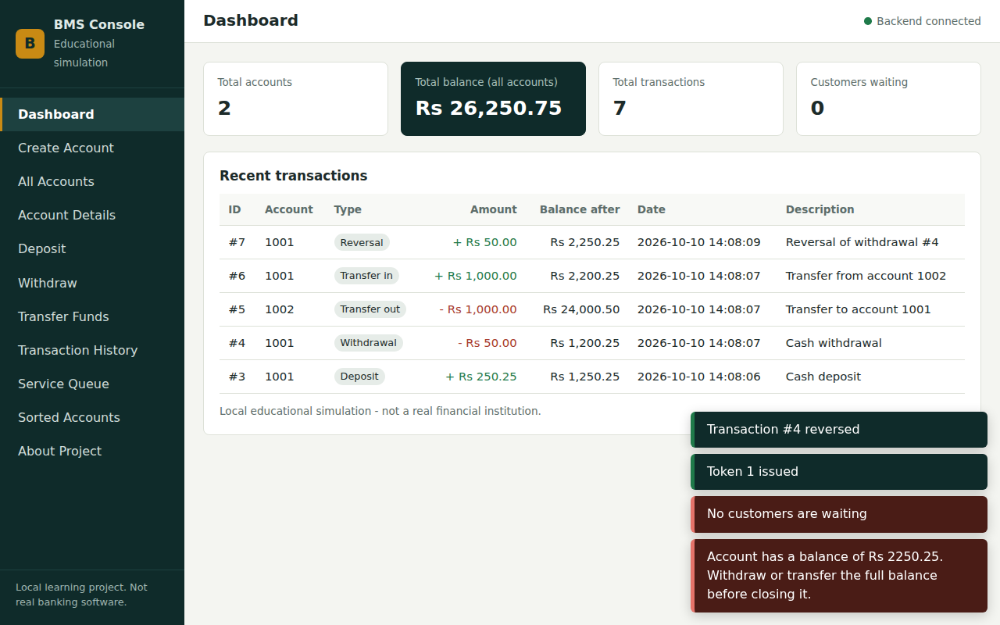

# Bank Management System (C++17, OOP, DSA, File Handling)

> **Educational project.** It simulates basic banking on your own computer. It is **not** production banking software, is **not** secure enough for the internet, and must never hold real money or real customer data.

## 1. Overview and problem statement
Small banks and students often manage accounts with ad-hoc spreadsheets. This project builds a small, understandable bank back-office system to show how classes, hand-written data structures and file storage work together in C++. A browser dashboard talks to a C++ HTTP server; all banking rules live in C++.

## 2. Objectives
1. Demonstrate Object-Oriented Programming (encapsulation, inheritance, polymorphism, composition, const-correctness, exceptions).
2. Demonstrate Data Structures and Algorithms written by hand (linked list, stack, queue, merge sort, searching).
3. Demonstrate permanent storage with C++ file handling (no database).
4. Provide a clean web UI connected to the real C++ backend.

## 3. Features
- Create accounts (Savings / Current), unique never-reused account numbers, close accounts (only at zero balance).
- Deposit, withdraw, transfer between accounts; safe validation of every amount.
- Transaction history (recent / per account), persistent across restarts.
- Undo (reversal) of the latest deposit or withdrawal, using a stack.
- Customer-service token queue (FIFO), persisted.
- Search by account number or holder name; sorted view by name or balance (merge sort).
- Dashboard: account count, total balance, transaction count, customers waiting, recent transactions.

## 4. Technology stack
| Part | Choice | Why |
|---|---|---|
| Language | C++17 | required; `std::filesystem`, `std::optional`, `<charconv>` |
| HTTP server | [cpp-httplib](https://github.com/yhirose/cpp-httplib) v0.18.3 | one header file, no build steps, serves static files too |
| JSON | [nlohmann/json](https://github.com/nlohmann/json) v3.11.3 | one header file, very readable API |
| Build | CMake (+ Ninja or Make) | works with MinGW, VS Code, Linux |
| Frontend | HTML5, CSS3, vanilla JavaScript | no frameworks |
| Storage | plain text files via `std::ifstream/ofstream` | required |

Both libraries are header-only and are downloaded automatically by CMake into `third_party/` (SHA-256 verified).

## 5. Architecture
```
Browser (frontend/*)  --HTTP/JSON-->  ApiServer  -->  BankService  -->  Bank  -->  FileStorage  -->  data/*.txt
 index.html, app.js,                  (routes only)   (validation,     (rules,     (read/write
 api.js                                                JSON, mutex)     DSA)        files)
```
- `ApiServer` has no banking logic. `BankService` has no HTTP code. `Bank` has no JSON or HTTP. `FileStorage` knows nothing about `Bank`.
- `Bank` composes `AccountLinkedList`, `TransactionHistory`, `TransactionStack`, `CustomerServiceQueue`, `FileStorage`.

### Data flow of one request (Deposit of Rs 250.25 into account 1001)
1. Browser: `app.js` checks the form, `api.js` sends `POST /api/transactions/deposit {"accountNumber":"1001","amount":"250.25"}`.
2. `ApiServer` parses the JSON (malformed -> 400) and calls `BankService::deposit`.
3. `BankService` takes a mutex, validates fields, converts `"250.25"` to integer paise (`25025`), calls `Bank::deposit`.
4. `Bank` finds the account in the linked list (O(n)), calls `BankAccount::deposit` (which validates *before* changing), records a `Transaction`, pushes it on the undo stack.
5. `Bank::commit` builds a snapshot and `FileStorage::save` writes every file to `*.tmp`, then renames them over the real files. If saving fails, memory is reloaded from the last good files and the error is returned (the balance does not change).
6. The result travels back up as JSON `{"success":true,"message":...,"data":...}` and the page shows a toast.

## 6. OOP concepts (details in `docs/OOP_CONCEPTS.md`)
- Encapsulation: `BankAccount` balance is private; changed only by validated methods.
- Inheritance + polymorphism: `BankAccount` (abstract) -> `SavingsAccount`, `CurrentAccount` with *different rules* (minimum opening deposit, withdrawal limit) via virtual functions.
- Composition: `Bank` owns list, stack, queue, history, storage.
- Const-correctness: `find()` has const and non-const overloads; getters are `const`.
- RAII / ownership: `unique_ptr` for accounts and storage, destructors free nodes; copying owning structures is deleted.
- Exceptions: one `BankError` type with an `ErrorCode`.

## 7. DSA concepts (details in `docs/DSA_COMPLEXITY.md`)
| Structure | File | Used for |
|---|---|---|
| Singly linked list | `AccountLinkedList` | primary in-memory account collection |
| Stack | `TransactionStack` | undo of deposits/withdrawals (LIFO) |
| Queue | `CustomerServiceQueue` | service tokens (FIFO) |
| Merge sort | `SortingAlgorithms.h` | sorted account view |
| Linear search | list `find`, `findByName` | account search |

## 8. File handling
Data folder (default `data/`, relative to where you start the server):

| File | Content |
|---|---|
| `accounts.txt` | `accountNumber|holderName|type|balancePaise|createdAt` |
| `transactions.txt` | `id|accountNumber|type|amountPaise|timestamp|balanceAfterPaise|relatedId|description` |
| `metadata.txt` | `next_account_number=`, `next_transaction_id=`, `next_token_number=` |
| `reversed_transactions.txt` | one transaction id per line (already reversed) |
| `customer_queue.txt` | `token|customerName|purpose|issuedAt` |

- Fields are separated by `|`; inside a field `\` becomes `\\`, `|` becomes `\|`, newline becomes `\n`. Lines starting with `#` are comments.
- **Money is stored as integer paise** (1 rupee = 100 paise). You type rupees such as `1500.50`; the server converts to `150050` paise. No floating point is used for money.
- Missing or empty files = empty data. **Malformed files make the server refuse to start** (it prints the file and line) and nothing is overwritten.
- Each save writes `*.tmp` files, checks every write, then renames them over the real files.
- Counters are saved so account numbers, transaction ids and token numbers are never reused, even after closing accounts or restarting.

**Backup / restore:** stop the server, then in PowerShell: `Copy-Item data data_backup -Recurse`. To restore: stop the server, delete `data`, and `Copy-Item data_backup data -Recurse`.
Never commit real data to GitHub; `.gitignore` already excludes `data/*.txt`.

## 9. Folder structure
See `PROJECT_STRUCTURE.md`.

## 10. Installation and run (Windows, PowerShell, VS Code)
> I developed and tested this on Linux (g++ 13.3). The Windows steps below use standard MSYS2/MinGW tooling but **I could not run them on Windows**. If something differs, see Troubleshooting.

### 10.1 Install the compiler and tools (one time)
1. Download and install **MSYS2** from https://www.msys2.org (default folder `C:\msys64`).
2. Open **"MSYS2 UCRT64"** from the Start menu (not the purple MSYS one) and run:
   ```bash
   pacman -Syu          # if the window closes, reopen UCRT64 and run it again
   pacman -S --needed mingw-w64-ucrt-x86_64-gcc mingw-w64-ucrt-x86_64-cmake mingw-w64-ucrt-x86_64-ninja mingw-w64-ucrt-x86_64-gdb
   ```
3. Add `C:\msys64\ucrt64\bin` to your Windows **PATH** (Start -> "Edit the system environment variables" -> Environment Variables -> Path -> New). Close and reopen PowerShell / VS Code.
4. In **PowerShell** check:
   ```powershell
   g++ --version
   cmake --version
   ninja --version
   ```
5. In VS Code install the extensions **C/C++** and **CMake Tools** (optional).

### 10.2 Dependencies
CMake downloads `httplib.h` and `nlohmann/json.hpp` automatically the first time you configure (internet needed). Manual alternative, from the project folder in PowerShell:
```powershell
New-Item -ItemType Directory -Force third_party\nlohmann | Out-Null
Invoke-WebRequest https://raw.githubusercontent.com/yhirose/cpp-httplib/v0.18.3/httplib.h -OutFile third_party\httplib.h
Invoke-WebRequest https://raw.githubusercontent.com/nlohmann/json/v3.11.3/single_include/nlohmann/json.hpp -OutFile third_party\nlohmann\json.hpp
```
Expected SHA-256 (check with `Get-FileHash <file> -Algorithm SHA256`):
`httplib.h` = `a0a0c13dc086663863dbe6730a19716f7d3744904b6205496e8301750814dbd5`
`json.hpp` = `9bea4c8066ef4a1c206b2be5a36302f8926f7fdc6087af5d20b417d0cf103ea6`

### 10.3 Configure and build (run in PowerShell, inside the project folder `BankManagementSystem`)
```powershell
cmake -S . -B build -G Ninja -DCMAKE_BUILD_TYPE=Release
cmake --build build
```
Linux/macOS: the same commands work (omit `-G Ninja` to use Make).

### 10.4 Run the tests
```powershell
.\build\bank_tests.exe
```
(Linux: `./build/bank_tests`.) Expect `41/41 tests passed`.

### 10.5 Start the server (startup order matters)
1. Run from the **project folder** (so it finds `frontend/` and `data/`):
   ```powershell
   .\build\bank_server.exe
   ```
2. Leave this window open. It prints the data folder and `http://localhost:8080`.
3. Open **http://localhost:8080** in your browser. Do **not** double-click `index.html`: the page needs the C++ server for everything.
Options: `--port 8081`, `--data some\folder`, `--frontend some\folder`.

### 10.6 Try it
1. **Create Account**: name `Asha Verma`, Savings, deposit `1000`. You land on the account details page.
2. Create a second account: `Bhanu Rao`, Current, `6000`.
3. **Deposit** `250.25` into 1001, **Withdraw** `50` from 1001.
4. **Transfer Funds**: from 1002 to 1001, `1000`.
5. **Transaction History**: see the records; use "Reverse this transaction" to undo the newest deposit/withdrawal.
6. **Check files** (second PowerShell window):
   ```powershell
   Get-Content data\accounts.txt
   Get-Content data\transactions.txt
   ```
7. **Restart:** press `Ctrl+C` in the server window, run `.\build\bank_server.exe` again, refresh the browser. Accounts, balances and history are still there. Create another account: its number continues (1003), nothing is reused.

### 10.7 Troubleshooting
| Problem | Fix |
|---|---|
| `g++` / `cmake` not recognised | PATH step 10.1(3) missing; reopen the terminal |
| Download fails during configure | Use the manual commands in 10.2 |
| "Could not listen on port 8080" | another program uses it: `.\build\bank_server.exe --port 8081` and open that port |
| Browser shows "Backend offline" | server not running, or you opened the file directly |
| Page is blank / 404 | start the server from the project folder, or pass `--frontend` |
| "Startup failed: accounts.txt line N ..." | a data file is damaged; fix that line or restore your backup. Nothing was overwritten |
| Linker errors about `ws2_32` | use a MinGW toolchain as above; CMake links it automatically on Windows |

## 10b. Put it online (no compiling)
See **`DEPLOY.md`**: upload to GitHub in the browser, deploy on Render with the included `Dockerfile` and `render.yaml`. Free plan limits (sleeping, data erased on restart) are explained there.

## 11. Screenshots
Sample screenshots taken during testing are in `docs/screenshots/` (`dashboard.png`, `history.png`, `mobile.png`). Replace them with your own: run the app, then save screenshots to `docs/screenshots/` (e.g. `dashboard.png`, `transfer.png`, `history.png`) and link them here:
```markdown

```

## 12. Known limitations
- **Not production software.** Only an optional single shared password (`BMS_PASSWORD`, HTTP Basic) and no HTTPS of its own (the host provides it), no authorization; the server binds to `127.0.0.1` only. Do not expose it to a network.
- **File atomicity is limited.** Each file is replaced atomically with a rename, but five files are replaced one after another. A crash or power cut *between* renames could leave files from two different saves. Not `fsync`ed. A real bank needs a database with transactions and a write-ahead log.
- **Whole files are rewritten on every change**: O(accounts + transactions) per operation. Fine for hundreds of records, not for millions.
- **Undo limitations:** only deposits/withdrawals are reversible (transfers are excluded). Only the *most recent* reversible transaction can be reversed (LIFO). If money has since left the account (for example by a transfer), the reversal is refused and stays on top of the stack, blocking older undos until the balance allows it. Reversing an *initial deposit* leaves an open account with balance 0.
- Single process, one lock around all operations; no concurrent servers sharing one `data/` folder.
- Account closure is not written as a transaction record.
- Names are stored as bytes (UTF-8 works), 1-60 bytes.

## 13. Future improvements
Login with hashed passwords, SQLite/transactional storage, interest calculation, per-account statements (PDF), reversal of whole transfers, a hash table index for O(1) account lookup, pagination, unit tests on Windows CI.

## 14. GitHub setup
```powershell
git init
git add .
git commit -m "Initial commit: bank management system"
git branch -M main
git remote add origin https://github.com/<your-username>/BankManagementSystem.git
git push -u origin main
```
Check `git status` first: `data/*.txt`, `build/` and `third_party/` must not appear (they are in `.gitignore`).

## 15. Verification status (honest summary)
See `docs/TESTING.md` for exactly what was run and what was not.
